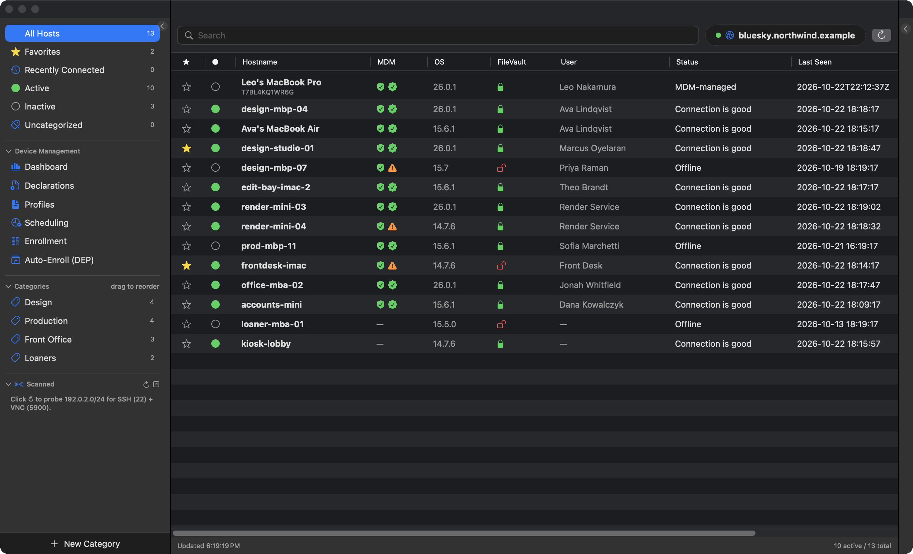
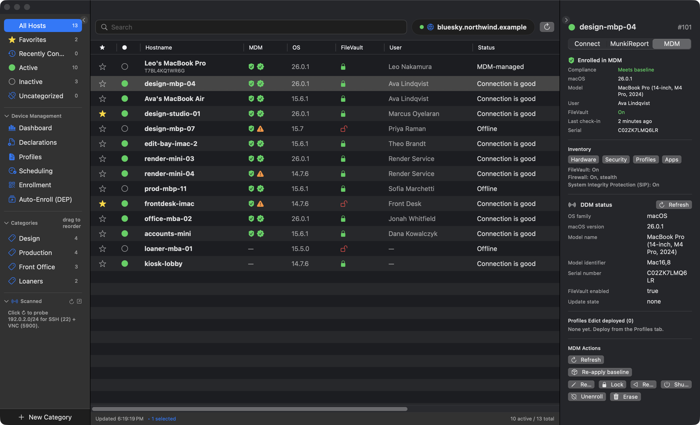
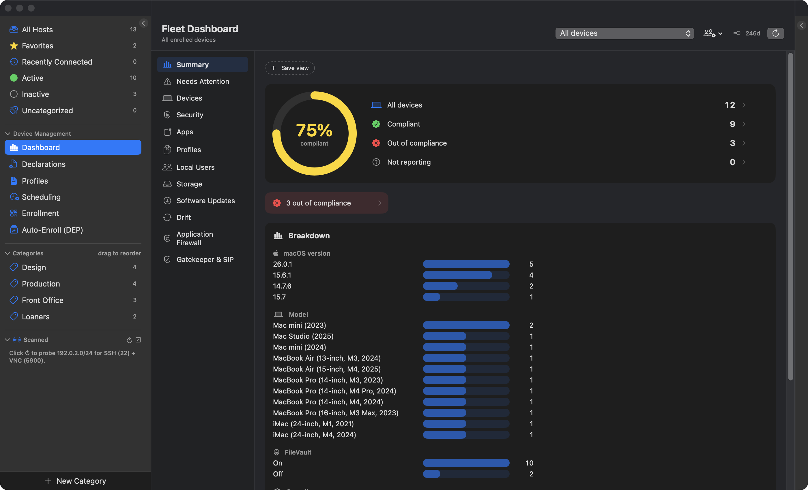
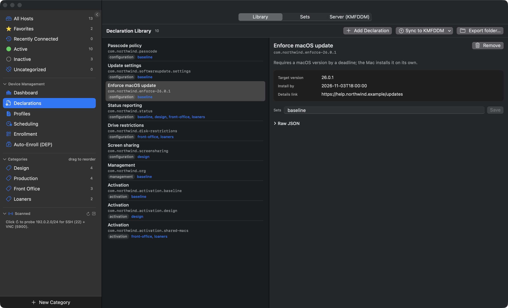
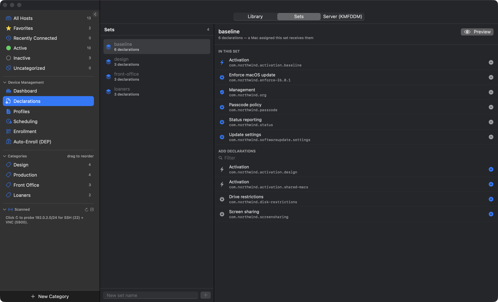
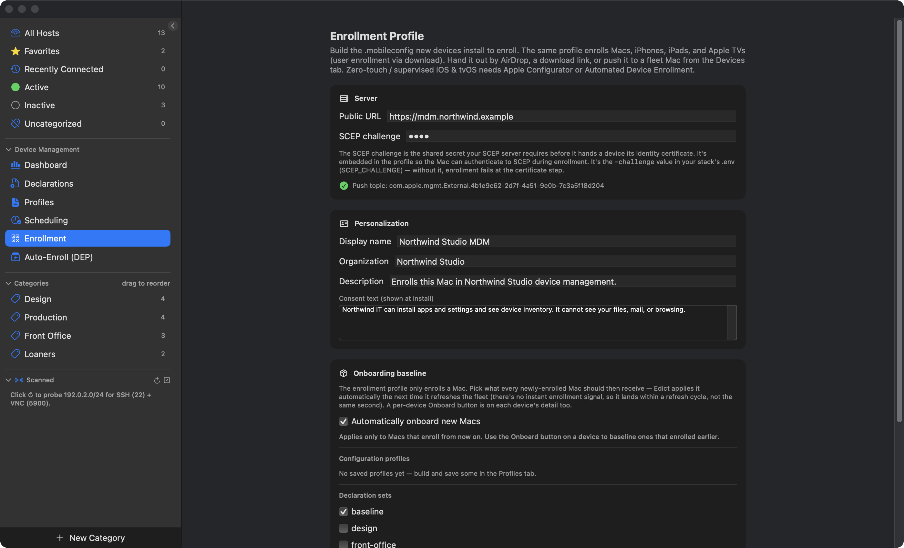
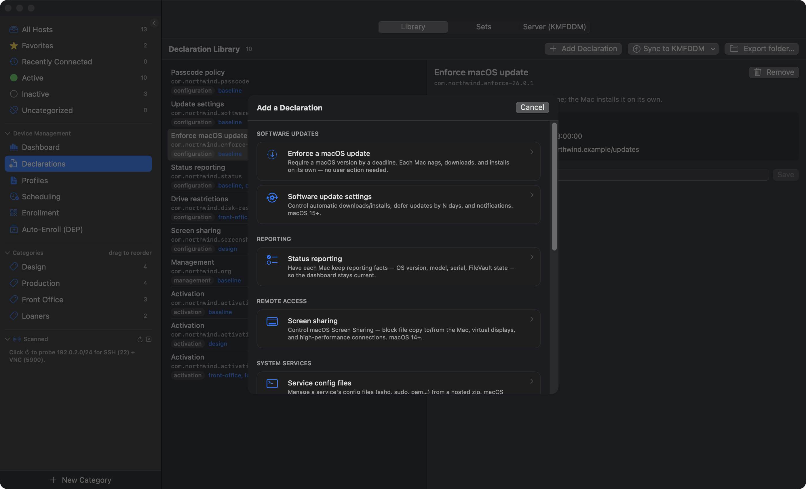
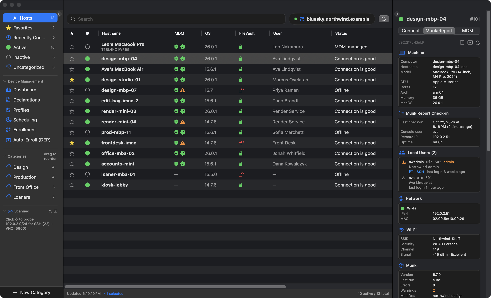

# Edict MDM

**One native macOS app for the whole Mac fleet: hands-on remote support and Apple device management, together.**

Edict MDM is the successor to **BlueConnect Admin**. Everything BlueConnect Admin did for [BlueSkyConnect](https://github.com/BlueSkyTools/BlueSkyConnect) fleets is still here (SSH, Screen Sharing, file and package installs, Quick Actions, Munki, MunkiReport), and Edict adds Apple device management on a self-hosted, open-source MDM stack: [NanoMDM](https://github.com/micromdm/nanomdm), [KMFDDM](https://github.com/jessepeterson/kmfddm) and SCEP, with optional [NanoDEP](https://github.com/micromdm/nanodep) for zero-touch enrollment.

It's one fleet table, one detail pane and one dashboard. There's no cloud tenant and no per-seat pricing: you point Edict at servers you run.



> [!NOTE]
> **Coming from BlueConnect Admin?** See [Upgrading from BlueConnect Admin](#upgrading-from-blueconnect-admin). Edict installs next to it, offers to import your settings and saved passwords on first launch, and talks to the same BlueSkyConnect server endpoints. MDM is optional: with no MDM server configured, Edict works like BlueConnect Admin.

> Status: **2.0.0 pre-release.** Built and used against a live fleet. Read [Honest limitations](#honest-limitations) before you rely on it.

---

## Contents

- [Why](#why)
- [Screenshots](#screenshots)
- [Highlights](#highlights)
- [Upgrading from BlueConnect Admin](#upgrading-from-blueconnect-admin)
- [How it fits together](#how-it-fits-together)
- [Requirements](#requirements)
- [Setup](#setup)
- [Deploying files (certificates and service config files)](#deploying-files-certificates-and-service-config-files)
- [Building from source](#building-from-source)
- [Honest limitations](#honest-limitations)
- [Built on](#built-on)
- [License](#license)

---

## Why

Most small fleets end up with a remote-support tool *and* an MDM, and the two never talk to each other. A Mac is a row in one and a row in the other, matched by hand. Edict matches them by serial number, so every host shows its MDM status next to its SSH session, and you can Screen Share to any MDM device or run a command on it without leaving the table.

It also treats **Declarative Device Management (DDM)** as a core feature. The part of DDM that most tools skip is the status channel, which tells you what a device actually *did* with a policy, not just what you sent. Edict reads that status back and shows it in plain English.

---

## Screenshots

> All screenshots use a fictional fleet. Names, serial numbers and servers are made up.

| | |
|---|---|
|  **Fleet.** BlueSkyConnect hosts and MDM enrollments in one table, matched by serial number. |  **Device detail.** Live inventory, DDM status and remote-support actions for the same Mac. |
|  **Prism dashboard.** A compliance ring, an attention strip and breakdowns by any attribute. |  **Declarations.** Plain-English templates instead of hand-typed JSON. |
|  **Sets grid.** See which Macs a policy reaches, and catch configurations that won't take effect. |  **Enrollment.** Build and sign the enrollment profile, and watch the push-certificate expiry date. |
|  **Template gallery.** Pick what you want to enforce, then fill in a form. |  **MunkiReport.** Users, network, Wi-Fi and Munki details for the selected Mac. |

---

## Highlights

### Device management (new in Edict)

**Fleet**
- One table merging BlueSkyConnect hosts and MDM enrollments, matched by serial number. Columns for MDM status, OS, FileVault and the logged-in macOS user.
- One detail pane for each Mac: live inventory, DDM status, compliance, and remote-support actions (Screen Share, SSH, run a command, send a file).
- Prism dashboard: a compliance ring, an attention strip you can act on (out of compliance, needs onboarding, drift, not reporting), and a breakdown by any attribute. Smart groups and saved scopes.

**Declarative Device Management**
- A declaration **library** with a gallery of plain-English templates, so the common cases need no hand-typed JSON. Templates: enforce a macOS update, software-update settings, status reporting, passcode policy, screen sharing, external and network-drive restrictions, install a certificate, and manage service config files (sshd, sudo, pam and others).
- **Activation predicates**, so a declaration applies itself only to devices that meet a condition.
- **Assets**: certificate and data files that the device downloads. The certificate and service-config-file templates use these.
- A **sets grid** that shows at a glance how many Macs each set reaches. It flags configurations that won't take effect because nothing activates them, fixes that in one click, and previews exactly what a Mac in a set receives.
- Sync to KMFDDM (add only, or make the server match exactly), export to a `ddm_examples`/`syncdir` folder you can keep in git, and import from files or from the server.
- A **per-device status view** of what each Mac reports back: OS, FileVault, software-update state and the reason a failed update failed, plus any errors applying declarations.

**Profiles and policy**
- A configuration-profile library: start from templates or import `.mobileconfig` files, then deploy with `InstallProfile`. Redeploying shows what changed, and Edict flags installed profiles that have drifted from what you sent.
- Onboarding baseline: automatically apply chosen profiles and DDM sets to newly enrolled Macs, plus policies per smart group.

**Enrollment**
- Build and sign the enrollment `.mobileconfig` with your Developer ID; a countdown shows when the push certificate expires.
- Automated Device Enrollment (DEP) through NanoDEP and Apple Business Manager: an account view, device list, profile builder and automatic profile assignment.

**Devices**
- Lock, erase, restart, shut down and rename. Live inventory (hardware, security, profiles, apps), compliance grading against a baseline, remote unenroll, an activity log and scheduled tasks.

### Remote support (everything from BlueConnect Admin)

- **Per-host buttons** for SSH, Screen Sharing (VNC) and file transfer (SCP) over the BlueSkyConnect reverse tunnel, plus a per-host SSH username for fleets that span several organizations.
- **Built-in terminal** with tabs, which you can detach into floating windows.
- **Quick Actions**: a browser of ready-made admin commands, plus your own recipes, run on one Mac or many.
- **Drag-and-drop**: drop a file on a host to send it, or a `.pkg`, `.dmg` or `.app` to install it with step-by-step progress.
- **Munki** repo browser and installer, a package catalog, and **MunkiReport** inventory in the side pane.
- **Erase / Reinstall macOS** in one structured sheet.
- **Block Host Permanently**, for Macs that have been sold or transferred.
- **Tech Support chat** with the user at the Mac.
- **Local Network** (Bonjour) and **Tailscale** sidebars, **UniFi** client lookup, a menu bar extra, Touch ID lock, and categories you can drag to reorder.

---

## Upgrading from BlueConnect Admin

Edict MDM is BlueConnect Admin's next major version under a new name. It continues the same version history: BlueConnect Admin ended at **1.5.6**, and Edict starts at **2.0.0**.

1. **Install Edict next to BlueConnect Admin.** It's a separate app (`Edict MDM.app`) with its own settings and Keychain entries, so the two don't conflict. Keep BlueConnect Admin until you're happy with Edict.
2. **Import on first launch.** Edict offers to copy BlueConnect Admin's preferences and saved passwords (BlueSky admin, MunkiReport, Munki repo, UniFi and others). It only fills in what Edict doesn't already have and never overwrites anything. macOS may ask once per saved password whether Edict may read BlueConnect Admin's Keychain item; click **Always Allow**.
3. **The server side doesn't change.** Edict uses the same BlueSkyConnect PHP endpoints as BlueConnect Admin 1.5.x. If you already ran `./deploy-server.sh` for 1.5.x, there's nothing to redeploy.
4. **Add MDM when you're ready.** It's optional. Settings → Device Management takes the NanoMDM, KMFDDM and enrollment-service URLs. Until you configure them, the fleet table shows BlueSkyConnect hosts only, as before.
5. **Retire BlueConnect Admin** once you've checked your hosts, categories and Quick Actions in Edict. Custom Quick Actions, favorites and recents are preferences, so the first-launch import brings them over. Categories and per-host usernames live on the BlueSkyConnect server, so both apps see the same ones.

---

## How it fits together

```
            ┌──────────────────────────────────────────────┐
            │                Edict MDM (macOS app)          │
            └──────────────────────────────────────────────┘
                 │            │              │            │
        admin APIs (tailnet)  │       BSC tunnel     MunkiReport API
                 │            │              │            │
   ┌─────────────┴───┐  ┌─────┴──────┐  ┌────┴─────┐  ┌───┴────────┐
   │ NanoMDM (MDM)   │  │ KMFDDM     │  │ BlueSky  │  │ MunkiReport│
   │ + SCEP          │  │ (DDM/sets) │  │ Connect  │  │ (optional) │
   │ + NanoDEP (opt) │  └────────────┘  └──────────┘  └────────────┘
   │ + enrollments   │
   │   sidecar       │     Apple devices enroll against the public,
   └─────────────────┘     reverse-proxied NanoMDM /mdm + /scep endpoints.
```

The app talks to the MDM servers' **admin** APIs over a private network such as Tailscale. Only the endpoints that devices use to enroll and check in are exposed publicly, through a reverse proxy.

> [!TIP]
> Devices must be able to reach the public `/mdm` and `/scep` URLs **from every network they join**. If you segment your LAN (a DMZ or guest VLAN, for example), allow that network to reach the reverse proxy on TCP 443. If you don't, enrollment fails during the SCEP step even though the server is healthy.

---

## Requirements

- **macOS 15 or later** to run the app.
- For remote support: a **BlueSkyConnect** server with the Edict / BlueConnect PHP endpoints deployed (see the [BlueConnect Admin 1.x README](README-BLUECONNECT-1x.md#server-setup)), an SSH key authorized on it, and BlueSky web-admin credentials.
- For device management (optional):
  - A **self-hosted MDM stack**: NanoMDM, KMFDDM, a SCEP CA, MySQL, and a small read-only enrollment service. NanoDEP is optional and only needed for Apple Business Manager zero-touch.
  - An **Apple MDM push certificate**, from the Apple Push Certificates Portal using a vendor certificate.
  - A public HTTPS endpoint for the `/mdm` and `/scep` paths that devices use.
- Optional: **MunkiReport** for extra inventory.

**Setting up the servers:** the **[setup wiki](wiki/Home.md)** walks through the Docker stack, the Apple push certificate, the network layout and connecting the app. NanoDEP and DEP details are under [`server/mdm/`](server/mdm/).

---

## Setup

1. **Stand up the stack**: NanoMDM, KMFDDM, SCEP and MySQL, plus the enrollment service. Bind the admin ports to your tailnet, not the public LAN.
2. **Point Edict at it** in Settings → Device Management. Enter the URLs for NanoMDM, KMFDDM and the enrollment service, plus their API keys (Edict stores the keys in the Keychain). **Test Connection** checks the whole path.
3. **Build the enrollment profile.** The Enrollment tab personalizes the `.mobileconfig` and signs it. Hand it out privately (it contains the SCEP challenge), or push it to a fleet Mac over the BlueSkyConnect tunnel.
4. **Write declarations** in Device Management → Declarations → Add. Pick a template, fill in the form, drop it into a set, and Sync.

---

## Deploying files (certificates and service config files)

Two templates push *files* to Macs: **Install a certificate** and **Service config files** (sshd, sudo, pam, cups and others). Apple's DDM never puts the file itself in the declaration; the device **downloads** it from a URL you host. Edict builds the three declarations for you: an **asset** holding the URL, the **configuration** that uses it, and an **activation**. You supply the file and the URL.

**To deploy a certificate:**

1. Export the certificate as **PEM** (or DER). Export the public certificate only, with no private key.
2. Host it at an **HTTPS URL** the Macs themselves can reach. Any static host works: an internal web server, object storage or a reverse proxy.
3. In Edict, go to **Declarations → Add → Install a certificate**. Enter a name, the HTTPS URL and the format, and choose whether the URL requires the device's MDM identity to download. Drop it in a set and Sync.

**To replace a service's config files (for example `sshd_config`):**

1. Put the service's config files in a folder and **zip** it. The layout must match what the service expects: for `com.apple.sshd` that's the contents of `/etc/ssh`, for `com.apple.sudo` it's `/etc/sudoers`, and so on.
2. Compute the **SHA-256** of the exact zip you'll host. Data assets require it.
3. Host the zip at an **HTTPS URL** the Macs can reach.
4. In Edict, go to **Declarations → Add → Service config files**. Pick the service, paste the zip's URL and SHA-256, choose whether the URL requires MDM authentication, drop it in a set, and Sync.

Both require **macOS 14 or later**, and service config files also require a **supervised** Mac. Built-in service types: `com.apple.sshd`, `com.apple.sudo`, `com.apple.pam`, `com.apple.cups`, `com.apple.apache.httpd`, `com.apple.bash`, `com.apple.zsh`, `com.apple.cryptoTokenKit`, `com.apple.authorization`.

---

## Building from source

```sh
swift build            # or open Package.swift in Xcode
bash build-app.sh      # produces a signed "Edict MDM.app"
swift test             # unit tests for the model and service layers
```

It's a Swift package that needs macOS 15 or later and SwiftUI. Storage is `@Observable`/`@AppStorage`, the Keychain, and JSON files under `~/Library/Application Support/EdictMDM/`. It doesn't use SwiftData. With Xcode 27, install the Metal toolchain first (`xcodebuild -downloadComponent MetalToolchain`), because the embedded terminal needs it.

---

## Honest limitations

- **You run the servers.** Edict is a client. It doesn't host MDM; it drives the NanoMDM, KMFDDM and NanoDEP servers you operate.
- **DEP hasn't been tested against a live Apple Business Manager token.** Automated Device Enrollment is built to the NanoDEP and Apple DEP web-service specs, and the app says so. Try it against a non-production ABM server first.
- **DDM configurations have OS minimums and platform limits.** Several need macOS 14 or 15, or a supervised Mac. The DDM account types are iOS/iPadOS-only, so Edict leaves them out. Each template states its requirements.
- **The certificate and service-config-file templates host their files by URL.** Apple downloads the certificate or zip from an HTTPS URL you host; the file isn't stored in the declaration.

---

## Built on

Edict is built on excellent open-source work: [NanoMDM](https://github.com/micromdm/nanomdm), [KMFDDM](https://github.com/jessepeterson/kmfddm), [micromdm/scep](https://github.com/micromdm/scep), [NanoDEP](https://github.com/micromdm/nanodep), [BlueSkyConnect](https://github.com/BlueSkyTools/BlueSkyConnect), [MunkiReport](https://github.com/munkireport/munkireport-php) and [SwiftTerm](https://github.com/migueldeicaza/SwiftTerm). Declaration schemas are checked against [apple/device-management](https://github.com/apple/device-management).

Not affiliated with or endorsed by Apple. Apple, Mac, macOS and Apple Business Manager are trademarks of Apple Inc.

## Support the project

If Edict saves you time, a tip is always appreciated.

[](https://buymeacoffee.com/echoparkbaby)

## License

[MIT](LICENSE). No warranty.
